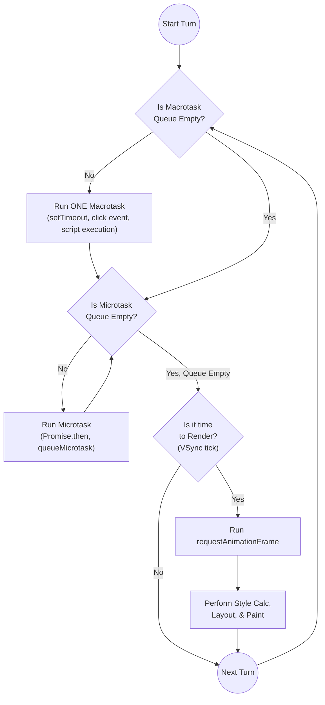
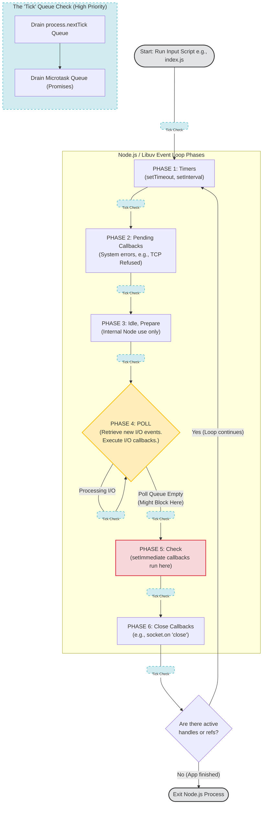

# 🌀 The Event Loop Masterclass: Browser vs. Node.js

> _Unmasking the single-threaded myth and mastering the asynchronous orchestration of JavaScript._
>
> **Note:** For Engine internals (V8, Hidden Classes) and Memory Management (Closures, GC), see [Closure.md](./Closure_Legacy/Closure.md).

---

## 🤝 Part 1: The Shared Foundation

Despite their differences, both environments share these core principles:

1.  **Single JavaScript Thread:** User-written JS runs on one thread with one Call Stack.
2.  **Offloading Work:** Both rely on the host (Browser Web APIs or Libuv) to handle slow tasks (network, timers, disk) in the background.
3.  **The Queue Concept:** When background work finishes, a callback is pushed into a queue waiting for the main thread to be free.
4.  **Microtask Priority:** In both modern browsers and Node.js (v11+), the microtask queue must be **completely emptied** before moving to the next major task or phase.
5.  **Control Yielding:** Both environments now support yielding control back to the loop to prevent UI/I/O starvation (e.g., `setTimeout(0)` or the modern **`scheduler.yield()`**).

### 📋 Macrotasks (Tasks) vs. Microtasks Breakdown

| Category               | Browser                                                                                                     | Node.js                                                                                       | Priority / Timing                                                                      |
| :--------------------- | :---------------------------------------------------------------------------------------------------------- | :-------------------------------------------------------------------------------------------- | :------------------------------------------------------------------------------------- |
| **Microtasks**         | `Promise.then/catch/finally`, `queueMicrotask`, `MutationObserver`                                          | `Promise.then/catch/finally`, `queueMicrotask`                                                | Drained **completely** whenever the Call Stack empties, before the next task or phase. |
| **Super Microtask**    | ❌ None                                                                                                     | **`process.nextTick`**                                                                        | Drained **before** standard microtasks (`Promise` / `queueMicrotask`).                 |
| **Macrotasks (Tasks)** | `setTimeout`, `setInterval`, DOM Events (`click`, `scroll`), `MessageChannel`, `postMessage`, I/O callbacks | `setTimeout`, `setInterval`, `setImmediate`, File I/O, Network I/O callbacks, Close callbacks | Executed **one at a time** (Browser) or in phased batches (Node.js Libuv).             |
| **Render Tasks**       | `requestAnimationFrame` (rAF) -> Style -> Layout -> Paint                                                   | ❌ None (No UI/Screen)                                                                        | Runs before paint synchronization (VSync), only in the browser.                        |

---

## 🏗 Part 2: The Multi-Threaded Reality of Node.js

### ❓ Is Node.js "Single-Threaded"?

- **The Nuanced Answer:** JavaScript execution is single-threaded (one call stack), but the **Node.js Runtime** is fundamentally multi-threaded.
- **The Main Thread:** Runs V8, the Call Stack, and the Event Loop orchestrator.
- **The Libuv Worker Pool:** A background thread pool (default: **4 threads**) that handles blocking or expensive OS tasks.
- **The Risk:** If you run a massive `while(true)` loop or recursive Fibonacci here, you **block the entire server**.

### ❓ The Libuv Worker Pool (The Hidden Threads)

Node.js = **V8 + Libuv**. Libuv implements a **Worker Pool** to handle operations that the OS doesn't provide non-blocking alternatives for.

- **The "4 Thread" Default:** By default, Libuv spins up 4 threads.
- **Tuning:** You can change this via `UV_THREADPOOL_SIZE=64 node app.js` (Max: 1024).

### ❓ What Tasks Go to the Worker Pool?

The main thread delegates slow/blocking operations to Libuv:

1.  **I/O-Bound (Expensive System Calls):**
    - **File System (`fs.*`):** Disk I/O is often blocking at the OS level. Libuv handles the `read()` call and notifies the loop when done. _(Note: fs.FSWatcher uses OS notifications like inotify, so it doesn't need the pool)._
    - **DNS Lookups (`dns.lookup`):** Resolving a domain via the OS resolver involves blocking calls (`getaddrinfo`). _(Note: `dns.resolve*` uses c-ares asynchronously without the pool)._
2.  **CPU-Intensive (C++ standard library tasks):**
    - **Crypto Module:** Functions like `pbkdf2()`, `scrypt()`, `randomBytes()` are designed to be slow. Node offloads them so user logins don't block other requests.
    - **Zlib (Compression):** Gzipping large streams is CPU-heavy and handled in the pool.

### ❓ Does Network I/O use the Worker Pool? (Major Interview Trap!)

- **Answer:** **NO.** Network I/O (`http`, `https`, `net`, `tls`, `dgram`) does **NOT** touch the Libuv worker pool.
- **How it actually works:**
  - Operating systems offer native non-blocking multiplexing primitives:
    - **Linux:** `epoll`
    - **macOS / BSD:** `kqueue`
    - **Windows:** `IOCP` (I/O Completion Ports)
  - The main thread registers socket file descriptors directly with the OS kernel. The kernel monitors sockets in hardware and notifies Libuv when bytes arrive or a buffer is ready to write.
  - **Why this matters:** This is the core reason Node.js can effortlessly sustain **100,000+ concurrent network connections** with a default thread pool of only 4 threads. Threads are only consumed by blocking disk I/O, DNS lookups, and crypto tasks.

### ❓ The 6-Step Workflow Summary

How Node handles an async task (e.g., `fs.readFile`):

1.  **Threads ≥ 5:** 1 Main thread + 4 Worker threads (minimum).
2.  **Delegation:** JS calls the async function.
3.  **Handoff:** Node's C++ bindings detect a "pool task" and give it to Libuv.
4.  **Execution:** A worker thread performs the blocking C++ code synchronously.
5.  **Completion:** The worker pushes the result/callback into the Event Loop's pending queue.
6.  **Notification:** The main thread, when free, picks up that callback and executes it.

### ❓ Beyond the Pool: `worker_threads`

- **Purpose:** Introduced to handle heavy JS math (image processing, encryption) without blocking the main loop.
- **Isolation:** Each worker has its own V8 instance and Event Loop.
- **Cost:** Memory-intensive. Use roughly one worker per CPU core.

---

## 🌐 Part 3: The Browser Event Loop (UI First)

### ❓ The Philosophy Difference

- **The Browser Loop** serves the **User Interface**. It prioritizes rendering and smoothness (~60fps).
- **The Node.js Loop** serves **High-Throughput I/O**. It is optimized for handling thousands of concurrent network/file connections.

### ❓ The Goal: Visual Responsiveness

The browser's event loop is orchestrated around the screen. Its goal is to ensure updates happen often enough (~60 frames per second) to create smooth motion.

### ❓ The Structure: The "Turn"

A single "turn" or tick of the browser loop follows a strict order, but with a critical nuance: **Microtasks run whenever the call stack becomes empty.**

1.  **Run ONE Macrotask:** The engine takes the oldest task (e.g., `setTimeout` callback, click handler, initial script execution) and runs it.
2.  **Drain Microtasks:** As soon as the stack is empty (even mid-task or after a macrotask), it processes **all** pending microtasks (Promises).
    - **Nuance:** If a microtask schedules another, it runs immediately—the loop won't move on until the queue is dry.
3.  **Starvation Hazard:**
    ```javascript
    function loop() {
      Promise.resolve().then(loop);
    }
    loop(); // Starves the event loop!
    ```
    The engine will stay in the Microtask phase forever, meaning the browser **never reaches the Render phase**. The UI freezes.
4.  **Render (Maybe):** The browser synchronizes with the display refresh (VSync).
    - **If it's time to render:** It executes `requestAnimationFrame` -> Style -> Layout -> Paint.
5.  **Loop:** Return to Step 1.

### 📊 Browser Loop Visualization



### ❓ `requestAnimationFrame` vs. `setTimeout` vs. `requestIdleCallback`

| Timing Mechanism                  | Where it Runs in the Loop                                                                 | Best Used For                                                                             |
| :-------------------------------- | :---------------------------------------------------------------------------------------- | :---------------------------------------------------------------------------------------- |
| **`requestAnimationFrame` (rAF)** | Right **before** Style, Layout, and Paint (synced to display VSync, ~16.6ms at 60Hz).     | Smooth DOM animations, visual UI updates. Prevents dropped frames and visual tearing.     |
| **`setTimeout(fn, 0)`**           | In the **Macrotask Queue** (clamped to minimum 4ms after 5 nested calls).                 | Deferring heavy non-visual CPU work to allow the browser to process inputs/paints first.  |
| **`requestIdleCallback` (rIC)**   | In the **Idle Period** between frame rendering tasks when the browser has spare CPU time. | Non-essential background work (analytics logging, pre-fetching data, pre-caching assets). |

### ❓ The Event Bubbling & Microtask Trap (User Click vs. `.click()`)

One of the most famous senior frontend interview questions revolves around when microtasks execute during DOM event dispatching:

```javascript
const button = document.querySelector('button');

button.addEventListener('click', () => {
  Promise.resolve().then(() => console.log('Microtask 1'));
  console.log('Listener 1');
});

button.addEventListener('click', () => {
  Promise.resolve().then(() => console.log('Microtask 2'));
  console.log('Listener 2');
});
```

- **Scenario A: A Real User Clicks the Button:**
  1. The browser dispatches the click as an event task. Listener 1 runs -> prints `Listener 1`.
  2. Listener 1 finishes -> **Call stack is empty!**
  3. The engine immediately drains pending microtasks -> prints `Microtask 1`.
  4. The browser runs Listener 2 -> prints `Listener 2`.
  5. Listener 2 finishes -> **Call stack is empty!**
  6. The engine drains microtasks again -> prints `Microtask 2`.
  - **Output:** `Listener 1` -> `Microtask 1` -> `Listener 2` -> `Microtask 2`.

- **Scenario B: Programmatic `button.click()`:**
  1. The script executes `button.click()`. The call stack now holds the script calling `.click()`.
  2. Listener 1 runs synchronously -> prints `Listener 1`.
  3. Listener 1 finishes, BUT the **call stack is NOT empty** (it still holds `button.click()`).
  4. The browser immediately invokes Listener 2 -> prints `Listener 2`.
  5. Both listeners finish and `button.click()` pops off the stack -> **Call stack is now empty!**
  6. The engine drains all queued microtasks -> prints `Microtask 1`, then `Microtask 2`.
  - **Output:** `Listener 1` -> `Listener 2` -> `Microtask 1` -> `Microtask 2`.

---

## 🟢 Part 4: The Node.js Event Loop (Libuv Phases)

### ❓ The 6 Phases of Libuv

Unlike the browser, Node moves through distinct sequential phases:

1.  **Timers:** `setTimeout`, `setInterval`.
2.  **Pending Callbacks:** System I/O errors (e.g., TCP connection refused).
3.  **Idle, Prepare:** Internal Node use.
4.  **Poll:** Most I/O happens here. **Node will block here** if the queue is empty and no timers are ready.
5.  **Check:** `setImmediate()` callbacks.
6.  **Close Callbacks:** `socket.on('close')`.

### ❓ The "Super Microtask": `process.nextTick()`

- Unique to Node.js.
- It runs **immediately** after the current operation, _before_ the Microtask queue (Promises) and _before_ the loop moves to the next phase.
- **Risk:** Recursively calling `nextTick` will starve the event loop entirely.

### ❓ `process.nextTick` vs. `queueMicrotask` (Final Boss Level)

While both are for "asynchronous" execution, they have different priorities in Node.js:

- **`process.nextTick`**: The "Super Microtask." It always runs **first**, before the microtask queue (Promises) and even before the loop moves to the next phase.
- **`queueMicrotask` (and Promises)**: Standard microtasks. They run after the current operation finishes but **after** the `nextTick` queue has been drained.
- **Starvation:** You can starve the event loop (and even Promises) by recursively calling `process.nextTick`.

### ❓ `setImmediate` vs. `setTimeout(..., 0)`

#### 1. At Top-Level (Main Script): Non-Deterministic Order

```javascript
setTimeout(() => console.log('timeout'), 0);
setImmediate(() => console.log('immediate'));
```

- **Why is the order unpredictable?**
  - In Node.js, `setTimeout(fn, 0)` is internally normalized to `setTimeout(fn, 1)` because timeouts cannot be `0ms`.
  - The entry into the event loop takes a few fractions of a millisecond.
  - **Case A:** If the computer is fast and loop startup takes `< 1ms`, the timer has not yet expired when Libuv reaches the **Timers** phase. Libuv moves through Poll into the **Check** phase -> `immediate` logs first!
  - **Case B:** If the system is busy and loop startup takes `≥ 1ms`, the timer has already expired when reaching the **Timers** phase -> `timeout` logs first!

#### 2. Inside an I/O Callback: 100% Deterministic Order

```javascript
const fs = require('fs');

fs.readFile(__filename, () => {
  setTimeout(() => console.log('timeout'), 0);
  setImmediate(() => console.log('immediate'));
});
```

- **Why `setImmediate` is guaranteed first:**
  1. The `fs.readFile` callback executes inside the **Poll phase**.
  2. The very next phase in the Libuv cycle is the **Check phase** (`setImmediate`).
  3. The **Timers phase** (`setTimeout`) cannot run until the entire loop iteration completes and wraps back around to the beginning.
  - **Output (Always):** `immediate` -> `timeout`.

### ❓ The Node.js 11+ Behavioral Shift (Microtask Timing Alignment)

One of the most consequential changes in Node's history:

- **Node 10 and earlier (Legacy):**
  - Microtasks (Promises, `nextTick`) only ran **between Libuv phases**.
  - If 5 timers expired together in the Timers phase, Node 10 would run Timer 1, Timer 2, Timer 3, Timer 4, Timer 5, and _only then_ drain microtasks.
- **Node 11+ (Modern / Current):**
  - Node aligned with the Browser (HTML5) specification.
  - Microtasks are drained **immediately after each individual timer or callback**, before moving to the next timer in the same phase!
  - **Result:** Identical asynchronous execution order between Browser and Node.js.

### 📊 Node.js Loop Visualization (Libuv)



---

## 🧩 Part 5: Async/Await & The Master Execution Order Puzzle

### ❓ How `async/await` Actually Interacts with the Event Loop

Many developers incorrectly assume `async/await` is a separate concurrency mechanism. In reality, it is purely syntactic sugar over Promises and Microtasks:

1. **Before the first `await`:** Everything executes **synchronously** on the current Call Stack.
2. **At the `await expression`:** The expression is evaluated synchronously (e.g. `await someFunc()`, `someFunc` runs immediately).
3. **Yielding control:** The JavaScript engine suspends execution of the async function, pops it off the Call Stack, and registers the remaining lines of the function as a **Microtask** attached to the resolved Promise.
4. **Resuming:** The remainder of the async function only executes when the Call Stack is empty and the Microtask Queue is drained.

### 🧠 The Ultimate Event Loop Execution Puzzle

Consider this comprehensive interview challenge:

```javascript
console.log('1: Script Start');

setTimeout(() => {
  console.log('2: setTimeout 1');
  Promise.resolve().then(() => console.log('3: Promise inside setTimeout'));
}, 0);

new Promise((resolve) => {
  console.log('4: Promise Executor (Synchronous!)');
  resolve();
}).then(() => {
  console.log('5: Promise 1 resolved');
});

async function asyncFunc() {
  console.log('6: AsyncFunc Start');
  await null;
  console.log('7: AsyncFunc After Await');
}
asyncFunc();

if (typeof process !== 'undefined' && process.nextTick) {
  process.nextTick(() => console.log('8: process.nextTick'));
}

queueMicrotask(() => console.log('9: queueMicrotask'));

if (typeof setImmediate !== 'undefined') {
  setImmediate(() => console.log('10: setImmediate'));
}

console.log('11: Script End');
```

---

### 🔍 Step-by-Step Execution Walkthrough

#### Step 1: Synchronous Phase (Call Stack)

1. `console.log('1: Script Start')` -> **Logs `1: Script Start`**.
2. `setTimeout(..., 0)` -> Delegated to Web API / Libuv Timers.
3. `new Promise(executor)` -> **Executes synchronously** -> **Logs `4: Promise Executor (Synchronous!)`**. Calls `resolve()`, queuing `.then()` to **Microtask Queue**.
4. `asyncFunc()` starts synchronously -> **Logs `6: AsyncFunc Start`**. Hits `await null`, yields execution, and queues the rest of `asyncFunc` to **Microtask Queue**.
5. `process.nextTick` (Node only) -> Queued to **NextTick Queue** (higher priority than microtasks).
6. `queueMicrotask` -> Queued to **Microtask Queue**.
7. `setImmediate` (Node only) -> Queued to Libuv **Check Phase**.
8. `console.log('11: Script End')` -> **Logs `11: Script End`**.
   - **Call Stack is now completely empty!**

#### Step 2: NextTick & Microtask Drainage

- **In Node.js:**
  - Drain `nextTick` queue first: **Logs `8: process.nextTick`**.
  - Drain standard microtasks in FIFO order:
    1. Promise 1 `.then()`: **Logs `5: Promise 1 resolved`**.
    2. `asyncFunc` post-await continuation: **Logs `7: AsyncFunc After Await`**.
    3. `queueMicrotask`: **Logs `9: queueMicrotask`**.
- **In Browser (no `nextTick`):**
  - Drains microtasks in FIFO order: **Logs `5` -> `7` -> `9`**.

#### Step 3: Macrotasks / Event Loop Phases

- **In Browser:**
  1. Picks the oldest Macrotask (`setTimeout 1`): **Logs `2: setTimeout 1`**.
  2. Creates a microtask (`Promise inside setTimeout`).
  3. Because the task finished and stack is empty, microtasks drain immediately: **Logs `3: Promise inside setTimeout`**.
- **In Node.js (v11+):**
  1. Enters Timers phase: Runs `setTimeout 1` -> **Logs `2: setTimeout 1`**.
  2. Microtask drains immediately before moving to next timer: **Logs `3: Promise inside setTimeout`**.
  3. Enters Check phase: Runs `setImmediate` -> **Logs `10: setImmediate`**.

---

### 🎯 Final Console Output Comparison

| Node.js (v11+) Output                | Modern Browser Output                |
| :----------------------------------- | :----------------------------------- |
| `1: Script Start`                    | `1: Script Start`                    |
| `4: Promise Executor (Synchronous!)` | `4: Promise Executor (Synchronous!)` |
| `6: AsyncFunc Start`                 | `6: AsyncFunc Start`                 |
| `11: Script End`                     | `11: Script End`                     |
| `8: process.nextTick`                | _(N/A)_                              |
| `5: Promise 1 resolved`              | `5: Promise 1 resolved`              |
| `7: AsyncFunc After Await`           | `7: AsyncFunc After Await`           |
| `9: queueMicrotask`                  | `9: queueMicrotask`                  |
| `2: setTimeout 1`                    | `2: setTimeout 1`                    |
| `3: Promise inside setTimeout`       | `3: Promise inside setTimeout`       |
| `10: setImmediate`                   | _(N/A)_                              |

---

## ⚖ Part 6: The Definitive Comparison Matrix

| Feature                        | Browser Event Loop                                     | Node.js Event Loop (Libuv)                                             |
| :----------------------------- | :----------------------------------------------------- | :--------------------------------------------------------------------- |
| **Primary Architectural Goal** | UI Responsiveness & Smooth 60fps/120fps Rendering      | High-Throughput Asynchronous Network & Disk I/O                        |
| **Loop Structure**             | One Macrotask -> Drain Microtasks -> (Optional) Render | 6 Sequential Phased Queues (Timers, Pending, Idle, Poll, Check, Close) |
| **Microtask Drain Timing**     | Whenever Call Stack empties, after every macrotask     | Whenever Call Stack empties, after every callback (Node 11+)           |
| **`process.nextTick`**         | ❌ Not available                                       | ✅ **Highest priority**; drains before all other microtasks            |
| **`setImmediate`**             | ❌ Non-standard (legacy IE only)                       | ✅ Dedicated **Check Phase** after Poll phase                          |
| **`MutationObserver`**         | ✅ Microtask (DOM change notification)                 | ❌ N/A                                                                 |
| **Rendering / Paint Phase**    | ✅ Core phase (`rAF` -> Style -> Layout -> Paint)      | ❌ N/A (Headless server runtime)                                       |
| **Idle Execution**             | `requestIdleCallback` (browser idle period)            | ❌ N/A                                                                 |
| **Minimum Timer Resolution**   | Clamped to **4ms** after 5 nested `setTimeout` calls   | Clamped to **1ms** minimum for `setTimeout(fn, 0)`                     |
| **Network Sockets**            | Offloaded to Browser Network Process                   | Native OS Kernel (`epoll` / `kqueue` / `IOCP`), **no threads**         |
| **Blocking File / DNS Tasks**  | Handled through Browser Host Sandboxes                 | Offloaded to **Libuv Worker Thread Pool** (default: 4 threads)         |

---

## 💡 Top Interview "Grilling" Questions

1. **"What is the priority difference between `process.nextTick` and `queueMicrotask`?"**
   - _Ans:_ `process.nextTick` has strictly higher priority. Node.js maintains a dedicated `nextTickQueue` that is completely exhausted before the engine inspects the standard microtask queue (`queueMicrotask`, resolved Promises).

2. **"Why is recursive `process.nextTick` or recursive `Promise.resolve().then()` dangerous?"**
   - _Ans:_ Both microtask queues must be completely empty before the event loop can progress to macrotasks, I/O, or rendering. Recursive microtasks cause **starvation**, indefinitely locking the main thread and freezing the UI or server.

3. **"How does Node.js handle 100,000 concurrent network connections with only 4 worker threads?"**
   - _Ans:_ Network sockets do **not** use the Libuv worker pool. Node registers socket file descriptors directly with the OS kernel's non-blocking multiplexer (`epoll` on Linux, `kqueue` on macOS, `IOCP` on Windows). The kernel monitors network packets asynchronously and wakes up Libuv when data is ready. Worker threads are only used for blocking disk I/O, DNS lookups, and crypto.

4. **"Why is the execution order of `setTimeout(fn, 0)` and `setImmediate(fn)` non-deterministic at the script root, but deterministic inside an I/O callback?"**
   - _Ans:_ At top-level, Node clamps `setTimeout(fn, 0)` to `1ms`. If loop initialization takes `< 1ms`, the timer has not expired when entering the Timers phase, so it skips to Poll/Check (`setImmediate` wins). If startup takes `≥ 1ms`, Timers phase runs first. Inside an I/O callback (`fs.readFile`), execution happens in the **Poll phase**, whose immediate successor is the **Check phase** (`setImmediate`), guaranteeing `setImmediate` runs before `setTimeout` (which must wait for the next loop iteration).

5. **"What changed in Node.js v11 regarding timer callbacks and microtasks?"**
   - _Ans:_ Prior to Node 11, Node processed all expired timers in the Timers phase in a single batch before executing microtasks. In Node 11+, Node aligned with the HTML5 browser spec: microtasks are now drained **immediately between each individual timer callback**.

6. **"Where does `requestAnimationFrame` (rAF) execute relative to Macrotasks and Microtasks?"**
   - _Ans:_ `rAF` callbacks execute as part of the **Rendering Phase** in the browser, immediately prior to Style recalculation, Layout, and Paint. They execute after the current Macrotask and all its microtasks have completely finished.

7. **"Why does clicking a button physically produce a different console order than calling `button.click()` programmatically?"**
   - _Ans:_ With a physical user click, the browser dispatches each event listener as a separate event task. After Listener 1 finishes, the Call Stack is empty, so microtasks drain immediately before Listener 2 runs. With `button.click()`, the call stack is not empty (it still holds the script that invoked `.click()`), so Listener 2 executes immediately; microtasks only run after both listeners and `.click()` finish.

8. **"How does `async/await` translate to Event Loop operations?"**
   - _Ans:_ Everything up to the first `await expression` executes synchronously on the stack. The engine evaluates the awaited expression, suspends the function, and attaches the rest of the function body as a microtask callback on the resulting Promise.

9. **"How can you schedule a macrotask in the browser without the 4ms clamping penalty?"**
   - _Ans:_ Use **`MessageChannel`** (`new MessageChannel().port2.postMessage(null)`). It schedules an immediate macrotask in the next tick without the browser's minimum timer delay clamp.

10. **"What happens in Libuv's Poll phase if the queue is empty and there are no ready timers?"**
    - _Ans:_ If `setImmediate` callbacks exist, Libuv immediately advances to the **Check phase**. If no `setImmediate` callbacks exist, Libuv will **block and wait** in the Poll phase for incoming I/O events, bounded by the shortest upcoming timer deadline.

11. **"Can `Promise.resolve().then(...)` block rendering in the browser?"**
    - _Ans:_ **Yes.** Because the browser specification requires the microtask queue to be fully empty before rendering (Style/Layout/Paint) can proceed, any long-running or recursive microtask chain will postpone the render pipeline and freeze the page.

12. **"Does `fs.readFile` run on the main thread?"**
    - _Ans:_ The initiation of `fs.readFile` and the eventual execution of its completion callback run on the main thread. However, the actual blocking read operation at the operating system level is executed synchronously by a background thread inside the **Libuv Worker Pool**.
